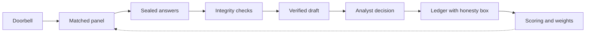

# Sealed Signals

Sealed Signals is the Risk Radar platform ACAPS does not have: the live Risk List from the ACAPS API, with an expert loop, a bias and integrity layer and a public audit trail built on top. It lets ACAPS ask a small, trusted panel of vetted experts (5-10, matched by geographic and thematic tags) to challenge and forecast its risk analyses in one minute, behind a mask each expert chooses. A daily "doorbell" watches open indicators mapped to the risk's own triggers and fires a pulse when something shifts (or when an analyst, or two experts, ask). Answers are sealed, opened together, aggregated with the surprisingly-popular method and reliability weights, turned into a cited draft update the analyst accepts or rejects, and published as a group view on a public ledger. When the risk resolves, every forecast is Brier-scored, weights update, and experts get a private calibration report. Nothing identifying ever leaves the expert's device; nothing publishes itself.

*The machine rings the doorbell, the panel answers, the analyst decides, the ledger remembers.*

Challenge: ACAPS "Ground Truth", Hackathon for Good #8, The Hague, 6-8 Nov 2026. Demo risk: R1043, escalating cross-border insecurity in eastern Chad.

## Why

ACAPS rates risks on probability and impact. Among the 104 resolved risks in the Risk Radar export, 32 of 38 High-rated risks materialised (84 %), but only 27 of 58 Medium-rated risks did (47 %). A Medium rating is close to a coin flip, and a reader cannot tell how it was reached or how often the ratings are right.

What we learned from ACAPS on 6 Nov:
- Experts are informed professionals who already track crises, not sources on the ground. They are matched on geography and theme, and a committee approves them.
- 32 analysts track their countries daily, score risks by hand and update weekly.
- There is no platform. Risk Radar is a dataset and an API.
- A panel could lean one way. The tool must be one validation layer among others, products never change automatically, and ACAPS must say what fed into each product. In the mentor's words: "We will get things wrong, like a prediction market; the point is honesty about it."

Sealed Signals is our answer: a loop that asks the right people at the right moment, keeps the answers honest, leaves the decision to the analyst, and keeps a public record of who was right.

More: [impact](docs/sealed-signals/impact.md) | [bias and honesty](docs/sealed-signals/bias-and-honesty.md) | [judging checklist](docs/sealed-signals/judging-checklist.md) | [demo script](docs/sealed-signals/demo-script.md) | [future work](docs/sealed-signals/future.md)

## How it works



1. **Doorbell.** Compares recent counts on open indicators with a 90-day baseline for each trigger in the risk. A shift fires a pulse.
2. **Matched panel.** Up to 8 approved experts, picked by geographic and thematic tags, with no more than 3 from one affiliation type.
3. **Sealed answers.** One card, 60 seconds, magic link, no login. Round 1 hides ACAPS's rating. Each answer is locked with a hash. The expert picks a mask: known, pseudonym or anonymous.
4. **Integrity checks.** Moderator-only: anchoring shift, herding, collusion, recency, coverage gaps, and corroboration of free-text claims.
5. **Verified draft.** An analyst-side assistant drafts the rating update. Every claim cites a panel aggregate, an indicator or an existing source. A checker marks what it cannot support.
6. **Analyst decision.** Accept, edit or reject. Only this step changes a rating.
7. **Ledger.** Public group view next to the ACAPS rating, a Verify button for the seal, and an honesty box (contributors, agreement, gaps, corroborated claims, past hit rate including misses, a caveat).
8. **Scoring.** When the risk resolves, Brier scores update weights. Each expert gets a private calibration report.

## Run

```
pip install -r engine/requirements.txt
make seed && make dev        # API on :18000
make ui                      # frontend on :5173
make demo                    # full loop on R1043, offline
make check                   # tests, UI build, fixture validation
```

Lane A and Lane B own this section and the architecture detail.

## Synthetic and live

| Part | Status |
|---|---|
| ACAPS Risk Radar export (139 risks, 57 countries, 104 resolved) | Real ACAPS data, used under ACAPS terms |
| Live Risk List through the ACAPS API | Live when a token is set; otherwise the CSV export is used. The badge on the Radar view says which. |
| Experts, panels, answers | **Synthetic.** No real expert data is used, as the challenge requires. Labelled "synthetic" in the product. |
| Indicator history for the Chad replay | Stored aggregated counts for the replay (`data/synthetic/indicators_chad.csv`). Lane A to state whether the counts are real or generated. |
| Proof chart (`reports/proof.png`) | Computed on the real outcomes of the 104 resolved risks, with synthetic experts. A test of the method, not of real experts. |
| Feature flags (`FF_ZK`, `FF_ANCHOR`, `LLM_BASE_URL`) | Default to the offline path. The demo states which path ran. We never claim a path that is off. |

## Limits

- Everything about expert behaviour is untested with real experts. The December pilot is the first real test.
- The proof simulation shows that the aggregation method works when experts carry signal. It does not show that real experts do.
- A small panel can lean one way. We cap composition, show coverage gaps in public, and rely on a committee gateway. We cannot prove independence.
- Anonymity: the mask is per answer; public output is aggregate only and never under 5 contributions. Default membership proof is an HMAC credential, not zero-knowledge.
- Brier scores on a few resolved questions per expert are noisy. Weights move slowly on purpose.
- Older imported ACAPS risks resolve over much longer periods than six months, so the 84 % and 47 % rates mix time frames.
- Impact: anticipatory-action evidence on cost and speed comes mostly from floods, droughts and harsh winters. We do not claim the same for conflict risks. See the impact note.

## Team

Zain Ul Haq (backend) | (frontend: name to add) | (research and pitch: name to add)

## ACAPS data terms

The Risk Radar export is shared by ACAPS for this challenge and is used under ACAPS's terms of use. Do not redistribute it outside this repository. No personal data of real experts is used.
